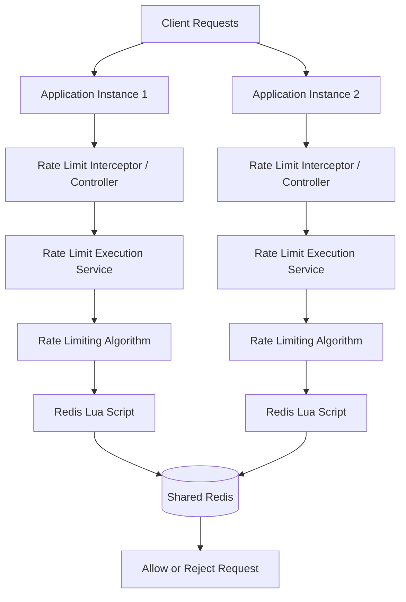

# Distributed Rate Limiter

A distributed rate-limiting service built with **Java 21, Spring Boot, Redis, and Lua scripting**. It controls incoming request traffic using configurable rate-limiting policies and maintains consistent rate-limit state across multiple application instances.

The service uses Redis Lua scripts to perform rate-limit operations atomically, preventing concurrent requests from bypassing configured limits.

## Features

- **Two rate-limiting algorithms:** Fixed Window and Token Bucket.
- **Distributed rate limiting:** Multiple Spring Boot instances share rate-limit state through Redis.
- **Atomic operations:** Redis Lua scripts execute rate-limit operations atomically.
- **Configurable policies:** Define bucket capacity, refill rate, and request cost through YAML.
- **Request interception:** Apply rate limits to controller endpoints using a custom `@RateLimited` annotation.
- **HTTP rate-limit responses:** Supports HTTP 429, `Retry-After`, and rate-limit headers.
- **Redis failure handling:** Configurable fail-open and fail-closed strategies.
- **Automated testing:** Unit tests, concurrency tests, and Redis integration tests using Testcontainers.
- **Containerization:** Docker and Docker Compose configuration with two application instances and shared Redis.

## Tech Stack

| Technology | Purpose |
|---|---|
| Java 21 | Programming language |
| Spring Boot 4 | Backend application framework |
| Spring Web MVC | REST API and request interception |
| Spring Data Redis | Redis integration |
| Redis 7 | Shared rate-limit state |
| Lua | Atomic rate-limit operations |
| Maven | Dependency and build management |
| JUnit 5 | Unit and integration testing |
| Mockito | Mock-based testing |
| Testcontainers | Redis integration testing |
| Docker | Application containerization |
| Docker Compose | Multi-container orchestration |
| Postman | API testing and performance testing |

## Architecture



Both application instances communicate with the same Redis service. Consequently, a user's rate-limit state is shared regardless of which application instance handles the request.

## Rate-Limiting Algorithms

### 1. Fixed Window

The Fixed Window algorithm limits the number of requests allowed within a fixed time interval.

Current implementation:

- Maximum requests: 5
- Window duration: 60 seconds
- Redis key: `rate_limit:user:{userId}`

The Redis Lua script increments the request counter and sets its expiration when the first request arrives in a window.

Once the request limit is reached, additional requests are rejected until the counter expires.

### 2. Token Bucket

The Token Bucket algorithm maintains a bucket of tokens for each user and policy.

Each incoming request consumes a configured number of tokens. Tokens are replenished over time at the configured refill rate, up to the bucket's maximum capacity.

The algorithm supports:

- Configurable bucket capacity.
- Configurable token refill rate.
- Configurable request cost.
- Remaining-token calculation.
- Retry-after calculation.

Redis stores the bucket state, while a Lua script performs token refill, request evaluation, and state updates atomically.

This prevents race conditions when multiple application instances process requests concurrently.

## Configurable Rate-Limit Policies

Policies are defined in `src/main/resources/application.yml`.

Example:

```yaml
rate-limiter:
  failure-strategy: fail-open

  policies:
    profile:
      capacity: 10
      refill-rate: 2
      request-cost: 1

    search:
      capacity: 5
      refill-rate: 1
      request-cost: 1

    payment:
      capacity: 3
      refill-rate: 0.5
      request-cost: 1

    distributed-test:
      capacity: 10
      refill-rate: 0.01
      request-cost: 1
```

| Policy | Capacity | Refill rate (tokens/sec) | Request cost |
|---|---:|---:|---:|
| profile | 10 | 2 | 1 |
| search | 5 | 1 | 1 |
| payment | 3 | 0.5 | 1 |
| distributed-test | 10 | 0.01 | 1 |

Each policy can be configured independently without changing the algorithm implementation.

## Redis Failure Handling

The application supports two configurable failure strategies.

### Fail-Open

When Redis is unavailable, requests are allowed to continue without rate-limit evaluation.

The response identifies that rate limiting was bypassed:

```http
RateLimit-Bypassed: true
```

The response also reports:

```json
{
  "allowed": true,
  "rateLimitEvaluated": false,
  "remainingTokens": null,
  "retryAfterSeconds": 0
}
```

### Fail-Closed

When Redis is unavailable, requests are rejected with HTTP 503 Service Unavailable.

Example response:

```json
{
  "message": "Rate limiting service is temporarily unavailable.",
  "error": "Service Unavailable"
}
```

Configure the strategy through:

```yaml
rate-limiter:
  failure-strategy: fail-closed
```

The current project configuration uses `fail-open`.

## API Endpoints

Base URL for the first application instance: `http://localhost:8080`

| Method | Endpoint | Description |
|---|---|---|
| GET | `/api/test-limit?userId=101` | Test Fixed Window rate limiting |
| GET | `/api/test-token-bucket?userId=101&policyName=profile` | Test Token Bucket rate limiting |
| GET | `/api/interceptor/profile?userId=101` | Test annotation-based rate limiting |
| GET | `/health/redis` | Check Redis connectivity |

### Token Bucket Example

Request:

```http
GET /api/test-token-bucket?userId=101&policyName=profile
```

Example response:

```json
{
  "allowed": true,
  "rateLimitEvaluated": true,
  "remainingTokens": 9.0,
  "retryAfterSeconds": 0
}
```

The `policyName` parameter defaults to `profile` when omitted.

### HTTP Rate-Limit Responses

The annotation-based interceptor rejects requests exceeding the configured limit with:

```http
HTTP/1.1 429 Too Many Requests
```

It also provides rate-limit headers:

```http
RateLimit-Limit: 10
RateLimit-Remaining: 0
Retry-After: 1
```

The actual values depend on the selected policy and current bucket state.

## Running the Project Locally

### Prerequisites

- Java 21 or later
- Docker Desktop
- Git

### 1. Start Redis

```powershell
docker run -d --name rate-limiter-redis -p 6379:6379 redis:7-alpine
```

### 2. Run the Spring Boot application

From the project root:

```powershell
.\mvnw.cmd spring-boot:run
```

The application starts on:

```text
http://localhost:8080
```

## Running with Docker Compose

Docker Compose starts:

- One Redis container.
- Two independent Spring Boot application containers.

The two application instances share the same Redis state.

### 1. Build and start all containers

```powershell
docker compose up --build -d
```

### 2. Verify container status

```powershell
docker compose ps
```

Expected services:

| Service | Host port | Container port |
|---|---:|---:|
| app-1 | 8080 | 8080 |
| app-2 | 8081 | 8080 |
| redis | 6379 | 6379 |

### 3. Test both application instances

First instance:

```powershell
Invoke-RestMethod "http://localhost:8080/api/test-token-bucket?userId=101&policyName=profile"
```

Second instance:

```powershell
Invoke-RestMethod "http://localhost:8081/api/test-token-bucket?userId=101&policyName=profile"
```

Both instances access the same Redis-backed rate-limit state.

### 4. View application logs

```powershell
docker compose logs -f app-1
```

```powershell
docker compose logs -f app-2
```

### 5. Stop containers

```powershell
docker compose down
```

To also delete the persistent Redis volume:

```powershell
docker compose down -v
```

**Warning:** The second command deletes the stored Redis volume and its data.

## Testing

Run the complete test suite:

```powershell
.\mvnw.cmd clean test
```

Build the application:

```powershell
.\mvnw.cmd clean package -DskipTests
```

### Test Coverage

The project includes:

- Rate-limit policy validation tests.
- Configuration validation tests.
- Rate-limit execution service tests.
- Redis failure-handling tests.
- MVC interceptor tests.
- Fixed Window concurrency tests.
- Token Bucket concurrency tests.
- Redis integration tests using Testcontainers.
- Optional distributed HTTP integration testing across two running application instances.

Testcontainers starts a real Redis container for integration testing when Docker is available.

### Distributed HTTP Integration Test

Start two application instances on ports 8080 and 8081, then execute:

```powershell
.\mvnw.cmd -Dtest=DistributedRateLimiterIntegrationTest -DrunDistributedIntegration=true test
```

This test sends 100 concurrent HTTP requests across the two instances using the same user and policy.

Verified result:

| Metric | Result |
|---|---:|
| Total requests | 100 |
| Allowed requests | 10 |
| Rejected requests | 90 |

The test verifies that both application instances enforce a single shared Token Bucket limit.

## Performance Testing

A local Postman Performance test was executed against both application instances.

Recorded results:

| Metric | Result |
|---|---:|
| Total requests | 31,280 |
| Test duration | 1 minute |
| Combined throughput | 543.78 requests/sec |
| Average response time | 7 ms |
| HTTP error rate | 0% |

The benchmark was performed locally using Docker and Postman. Results depend on the machine, container resources, and test configuration.

**Important:** The test endpoint returns HTTP 200 for both allowed and rate-limited decisions, with the decision represented in the JSON response. Therefore, the 0% HTTP error rate does not mean that all requests were allowed.

These figures are preliminary local measurements, not production-scale performance claims.

## Project Structure

```text
distributed-rate-limiter/
│
├── src/
│   ├── main/
│   │   ├── java/com/ratelimiter/
│   │   │   ├── algorithm/
│   │   │   │   ├── FixedWindowRateLimiter.java
│   │   │   │   └── TokenBucketRateLimiter.java
│   │   │   │
│   │   │   ├── annotation/
│   │   │   │   └── RateLimited.java
│   │   │   │
│   │   │   ├── config/
│   │   │   ├── controller/
│   │   │   ├── exception/
│   │   │   ├── interceptor/
│   │   │   ├── model/
│   │   │   ├── redis/
│   │   │   └── service/
│   │   │
│   │   └── resources/
│   │       ├── application.yml
│   │       └── scripts/
│   │           ├── fixed_window.lua
│   │           └── token_bucket.lua
│   │
│   └── test/
│       └── java/com/ratelimiter/
│
├── .mvn/
├── .dockerignore
├── .gitignore
├── docker-compose.yaml
├── Dockerfile
├── mvnw
├── mvnw.cmd
├── pom.xml
└── README.md
```

## Current Scope and Future Improvements

The current Docker Compose setup runs two application containers with shared Redis. Each application instance is exposed on a separate host port; an external load balancer is not included in the current Compose configuration.

Potential future improvements:

- Add an Nginx or cloud load balancer.
- Introduce authentication and API-key-based client identification.
- Add Redis authentication and production secret management.
- Add observability with metrics, dashboards, and distributed tracing.
- Perform load testing in a controlled deployment environment.
- Deploy the service to a cloud environment with managed Redis.

## Author

Developed as a backend engineering project to explore distributed systems, concurrency control, Redis atomic operations, and scalable request-rate enforcement.